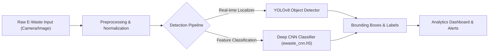

# ♻️ Creonix E-Waste Classifier & Segregation Engine


An intelligent deep learning pipeline developed for the **CREONIX ’25 Hackathon** to automate the detection, classification, and sorting of electronic waste (E-Waste) into actionable recycling categories (PCBs, Batteries, Cables, Displays, etc.).

---

## 📌 Project Overview
E-waste is one of the fastest-growing waste streams globally, containing hazardous heavy metals as well as recoverable precious materials. Manual sorting is slow, hazardous, and error-prone. 

**Creonix E-Waste Classifier** provides:
- **Dual Architecture**: A custom Convolutional Neural Network (CNN) combined with fine-tuned **YOLOv8** for real-time edge bounding box detection and categorization.
- **Multi-Class Detection**: Accurately recognizes components including Printed Circuit Boards (PCBs), Lithium-ion batteries, mobile motherboards, power cables, and CRT/LCD screens.
- **Real-Time Video Feeds**: Webcam and conveyor belt inspection script with automated FPS and confidence thresholding.
- **Interactive Dashboard**: Modern analytics web dashboard displaying live detection streams, class distribution metrics, and confusion matrix analytics.

---

## 🏗️ System Architecture


---

## 📂 Project Structure
```text
easwari/
├── CREONIX_’25_Hackathon_Problem_Statement[1].pdf
├── Flowchart Explanation_ Object Detection and Classification Pipeline.pdf
├── Object Detection and Classification Pipeline (1) fin.pdf
├── 🔑 Step 1.docx
├── ewaste/
│   ├── app.py                   # FastAPI / Web service
│   ├── app1.py                  # Secondary prediction service
│   ├── real_time_ewaste.py      # Real-time webcam inference loop
│   ├── predict.py               # Standalone image inference script
│   ├── train.py                 # Deep CNN training script
│   ├── train.ipynb              # Model exploration notebook
│   ├── ewaste_cnn.h5            # Pre-trained CNN weights
│   └── requirements.txt         # Dependencies
└── waste/
    ├── runs/cls/ewaste/         # YOLOv8 classification training runs & metrics
    │   ├── weights/best.pt      # Best fine-tuned YOLO model weights
    │   ├── confusion_matrix.png # Model confusion matrix
    │   └── results.png          # Precision, recall, and loss graphs
    └── templates/
        └── dashboard.html       # Web visualization UI
```

---

## 🚀 Quickstart & Setup

### 1. Installation
```bash
cd ewaste
python -m venv venv
venv\Scripts\activate
pip install -r requirements.txt
pip install ultralytics opencv-python tensorflow
```

### 2. Run Real-time Detection
```bash
python real_time_ewaste.py
```

### 3. Launch Dashboard
```bash
python app.py
```
